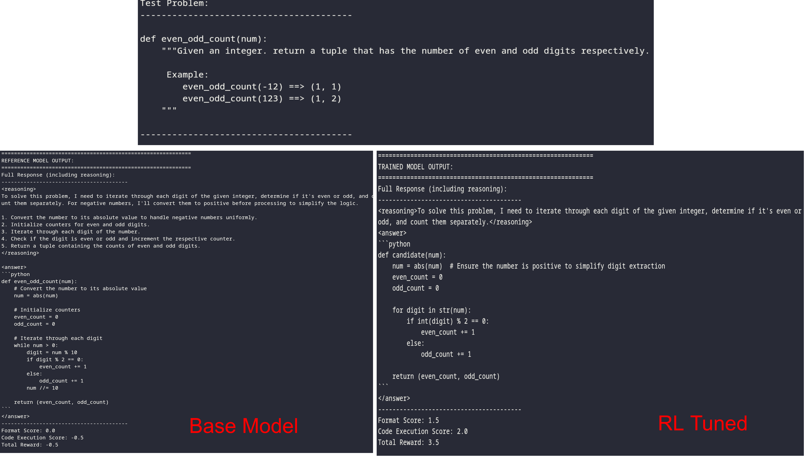

# GSPO: Group Sequence Policy Optimization

A minimal implementation of GSPO from scratch for code generation tasks, based on the paper [GSPO: Group Sequence Policy Optimization for Code Generation](https://arxiv.org/abs/2507.18071).

Finetuning `Qwen/Qwen2.5-3B-Instruct` for *openai/human-eval*.

Results (on holdout set):

* Pass rate of base model: 3/16  (primarily  formatting issues + code accuracy)

* Pass rate of Finetuned model: 13/16




Install dependencies:

```bash
pip install torch transformers datasets tqdm huggingface_hub
`````

Run the code with (H200)

```
torchrun --nproc_per_node=8 gspo-code.py
```

Key references:
1. https://github.com/mingyin0312/RLFromScratch
2. https://arxiv.org/abs/2507.18071

